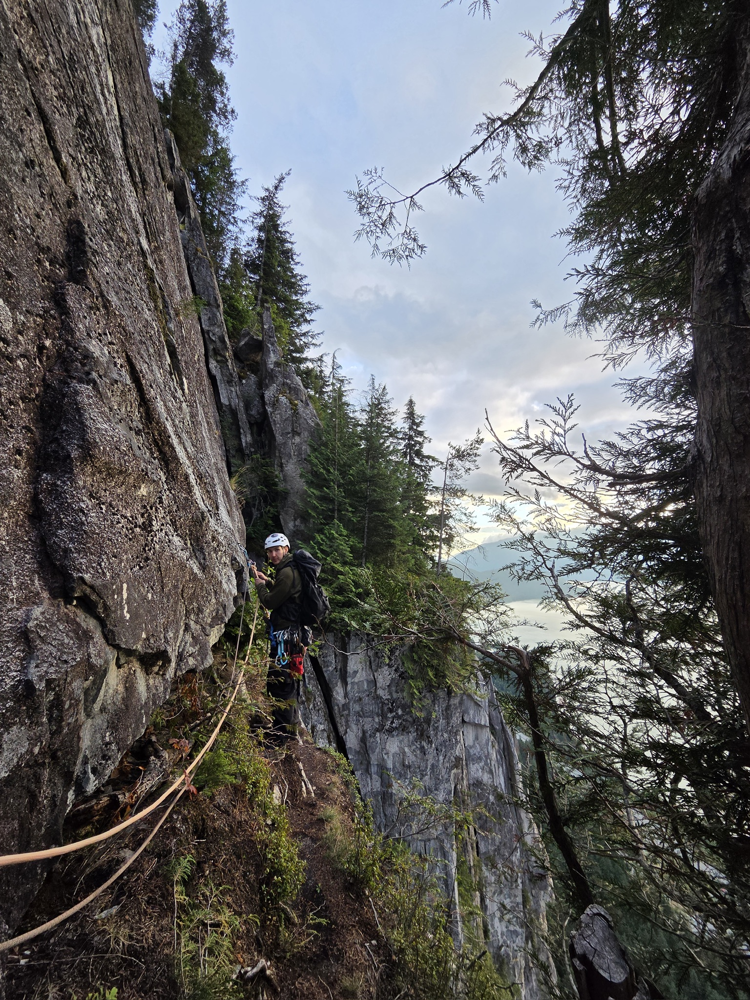

### Daniel R

`software engineer` · `rope access technician`

I'm intrested in **Computer Science**. I frequently build side projects that I am passionate about, and love exploring new systems.

- I also do rope access and rock climbing on the side.

### Connect with me

Photo taken in Squamish at [The Cheif](https://www.google.com/maps/place/Stawamus+Chief/@49.6866799,-123.1452997,2652m/data=!3m2!1e3!4b1!4m6!3m5!1s0x5486f7f4d65cef61:0x730e696e5b39504f!8m2!3d49.686667!4d-123.135!16zL20vMDd0ZDU5?entry=ttu&g_ep=EgoyMDI2MTExMC4wIKXMDSoASAFQAw%3D%3D)

 

---

### Skills

